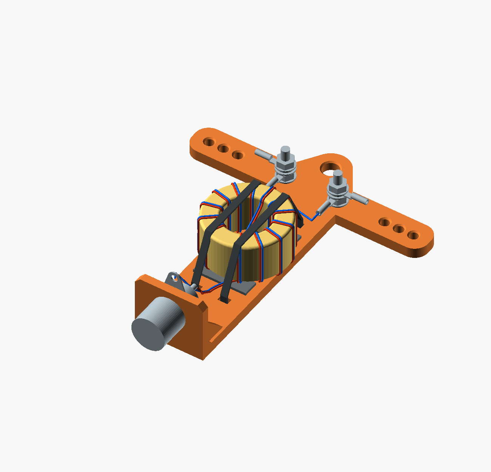

# Open 1:1 balun dipole center

The `balun_mount=true` configuration of the shared
[BNC dipole center](../dipole_center/README.md), with an exposed, zip-tied
current balun between the BNC and antenna terminals. Independently enable
`strap_slots=true` for packing strap openings on the terminal bar.
The loaded toroid's fit in the nesting winder packing pose is not established.
Use **one Fair-Rite 2631801202 mix 31 core and 13 bifilar turns**:
six ordinary paired turns, one crossover aperture passage, then six ordinary
paired turns. The crossover is turn 7 and counts toward all 13 turns per conductor.
The guide prototype uses **BNTECHGO 22 AWG polyurethane-enamelled copper**,
ASIN B07DYF89T9, with two continuous conductors.
The owned 22 AWG FEP is also a viable comparison winding, subject to RF
measurements. Use a crossover to bring the BNC leads out below and the
antenna leads out above. Intended for a resonant/linked
40/30/20/17/15 m dipole, emphasizing 40/20 m, normally 12/50 W CW.
**100 W is the design goal, not a tested rating.**

**Prototype, 17 September 2026:** the center has CAD and numerical checks;
see the [winding guide](winding-guide.md) for the separate guide's validation.
Printing, hardware fit, RF measurements and power testing remain to be done.
This project has not been uploaded to Printables. It is intended for its own
listing after the design and physical prototype are accepted.



[Printable STL](balun_dipole_center.stl) · [Shared OpenSCAD source](../dipole_center/dipole_center.scad)
· [Balun preset](balun_dipole_center.scad)
· [Mount fit coupon](mount_fit_coupon.stl) · [BNC fit coupon](bnc_fit_coupon.stl)
· [Bare printed part](preview.png) · [Front](front.png) · [Side](side.png)
· [Guide STL](winding_guide.stl) · [Guide source](winding_guide.scad)
· [Guide preview](winding_guide.png) · [Numbered winding debug view](winding_debug.png)
· [Installed cutaway showing ferrite](assembly_cutaway.png)

The center and winding guide are separately printable parts. Ferrite, two
colored conductors, pads, ties and metal hardware are assembly references
and are absent from the printable STLs.
Wire colors distinguish the two conductors; enamel need not be those colors.

## Compact layout

| Feature | Default |
| --- | ---: |
| Printed width × operating height × depth | 90 × 100 × 23 mm |
| Center-only solid PETG estimate at 1.27 g/cm³ | 17.69 g |
| Backplate / BNC shelf thickness | 4 / 3 mm |
| Bare core, OD × ID × height | 29 × 19 × 13.85 mm; 24 g |
| Reserved maximum wound package | Ø34 × 18 mm |
| Toroid center, X/Y | 0 / 45 mm |
| M3 terminal centers | X±10, Y82 mm |
| Three wire holes per leg | Ø3.2, X±28/33.5/39, Y82 mm |
| Suspension eye | Ø6, Y93 mm |
| BNC cutout | Ø9.5 D-hole, −0.10 mm adjustment per side |
| Tie slots | Four 3.4 × 2.4 mm bores, 0.3 mm edge breaks |
| Tie slot centers | X±5.5, Y24/66 mm |
| Separate compliant pads | Two 20 × 6 × 1 mm, centered at Y32/58 mm |
| Wound package to nearest 7 mm washer edge | 16.5 mm (vertical separation) |
| Maximum Panduit barrel end to wire-hole mouth | 4.724 mm |
| BNC rear envelope above shelf | 13 mm; catalog nominal about 12 mm |
| BNC envelope to wound bottom | 12 mm |
| Wound top to M3 post center | 20 mm |
| Downward winding-ring barrel to wound top | 8.824 mm (vertical separation) |
| BNC envelope to lower tie-slot mouth | 6.5 mm |

The original shelf, D-hole profile, ribs and internal root reinforcement are
retained, with the BNC opening reduced to the **9.5 mm printed-fit selection**
from the nesting dipole project. The anti-rotation flat moves with the circular
diameter: `bnc_clearance=-0.10` relative to the 9.7 mm nominal drawing.
The complete terminal bar and suspension eye move upward 61 mm; their holes
and hardware spacing are unchanged. A narrow spine supports the toroid without
an enclosure. The antenna-side rings point outward toward the wire weaves; a second
winding-side ring on each post points downward toward the toroid. With packing
strap slots enabled, the posts and wire groups move 3 mm inward together,
and the automatic suspension-eye diameter becomes 8 mm; table coordinates
above describe the preset without packing slots.

The 34 × 18 mm wound allowance includes core dimensional tolerances, wire
and thin protective tape. It is a design allowance, not a measured package.
Allow about 27 mm assembled thickness with front straps and rear tie heads,
plus the BNC body projecting below the printed shelf. The core and printed
center weigh about 42 g; the separate guide, wire, BNC,
terminal hardware, pads and ties are additional.

## Core and turns

The core is listed in the [N1RWJ parts bin](https://rwjblue.com/radio/equipment/parts-bin/).
[Fair-Rite specifies](https://fair-rite.com/product/toroidal-suppression-core-2631801202/)
29 ±0.75 mm OD, 19 ±0.50 mm ID and 13.85 ±0.40 mm height, with 24 g catalog mass.

The new study in the sibling `antenna-lab` repository compares single and
stacked 22 mm and 29 mm mix 31 cores, FT114/FT140 mix 43, and the 61 mm mix 31
core, with 10–14 turns. It uses manufacturer complex data with explicit
capacitance scenarios. Reproduce it there with `mise run bifilar-choke`;
see `results/bifilar-choke-v1/README.md` and
`docs/case-studies/bifilar-choke.md` for the full results and assumptions.

The 29 mm core provides a useful aperture and thermal capacity without the
bulk of the 61 mm core. Two stacked 22 mm cores remain a possible lighter
experiment, but have a tighter aperture. Mix 43 can also make a current choke;
mix 31 is the first choice here for the lower-HF emphasis and exact-part
measurement evidence.

**This guide fixes the winding at 13 turns per conductor:** turns 1–6,
the paired crossover through the aperture as turn 7, then turns 8–13.
All aperture passages must contribute in the same magnetic sense.
The earlier electrical study's 12-turn baseline remains a comparison, not
the turn count for this guide. Extra turns raise magnetic impedance but can
hurt the upper bands once capacitance bypasses the winding. Both 12 and 13
turn scenarios can miss the 20 m target at higher assumed capacitance.
The model is a screening tool, not proof of all-band choking.
The [electrical build and test guide](electrical-design.md) gives the circuit,
RF acceptance targets, and steps toward qualifying 100 W use.

## Separate winding guide

The [guide source](winding_guide.scad) makes a thin open-bottom cup over the
annular top face and both cylindrical walls; the core inserts from underneath.
Its paired channels keep the intended wire center spacing along the supported
path. The six ordinary turns on each side are distributed automatically,
with space reserved for the paired crossover and lead exits. Input leads
face the BNC below the core and output leads face the antenna terminals above.

Core OD, ID and height are independent parameters with nominal defaults
29.00, 19.00 and 13.85 mm. Adjust them for the measured core; the separate
fit clearance defaults to 0.15 mm per surface. Finished wire OD defaults to
0.650 mm and the requested gap between enamel surfaces to 0.100 mm:
`wire_center_spacing = wire_od + wire_surface_gap = 0.750 mm`.
The wire's approximately 0.644 mm bare copper diameter and advertised
0.650 mm finished diameter do not verify its enamel thickness. Measure the
actual wire before treating the prototype default as a fit measurement.

Groove fit clearance does not increase the intended wire center spacing.
It reduces the printable ridge between channels; the ridge also depends on
groove depth and is a separate quantity from wire surface gap. The spacing is an electrical
prototype setting, **not a validated 50 Ω geometry**. See
[winding-guide.md](winding-guide.md) for the parameter list, printability
warnings, dimensions against the Ø34 × 18 mm allowance, installation,
winding sequence and validation results.

## Parts and fit check

- One printed center, one separately printed guide, one 2631801202 core,
  and two continuous lengths of
  [BNTECHGO 22 AWG polyurethane-enamelled copper](https://www.amazon.com/dp/B07DYF89T9)
  (ASIN B07DYF89T9), optional short 22 AWG FEP pigtails and insulating sleeves.
  Size the wires from the guide's modeled path plus generous termination
  tails; trim only after dry fitting. Record the wire and enamel build;
  measure its finished diameter. Gauge alone
  does not establish insulation voltage or line Z0.
- Two 2.5 × 150 mm nylon ties, preferably UV-resistant, and two thin compliant
  silicone or suitable closed-cell pads. Check actual tie width/thickness.
- Amphenol RF **31-221-RFX** BNC panel jack with its nut/washer/shell tag.
- Two M3 × 16 mm screws as a starting length, four nuts and eight small
  washers, approximately 7 mm OD. Select the final screw length by dry fit.
- Panduit **P22-6R-M** uninsulated ring terminals for the antenna and stripped
  22 AWG winding leads or pigtails. Verify the crimp on a sample, especially
  when using solid magnet wire.
  The inventory's TE 31428 #4 ring has a 3.02 mm hole and is not an assumed
  clearance fit over M3. Do not substitute it without checking.

The Panduit terminal is specified for 26–22 AWG copper. If trying the owned
18 AWG magnet wire instead, use a short soldered, insulated splice to 22 AWG
FEP or an appropriate larger-wire eyelet; do not force 18 AWG into this terminal. For the planned
DXE-SANTW copper-clad steel antenna wire, sample crimp/pull/flex tests remain
necessary. Completely strip enamel before terminating magnet wire. Do not
rely on a crimp to pierce enamel or put antenna tension on a winding lead.

Print the **mount fit coupon first** to check the entire core/BNC/tie stack
and terminal screws. It retains the full 26 × 76 mm central area and exact
shelf. Use the smaller upright BNC coupon if the connector fit is uncertain.
Its cutouts are 9.5, 9.7 and 9.9 mm at the actual 3 mm panel thickness;
the 9.5 mm cutout matches the center and mount coupon. The selected fit is
empirical for the tested connector and print profile.
The manufacturer's maximum panel thickness is 3.3 mm.

Measure the assembled BNC projection above the shelf, including the contact
and the planned soldered connection. The CAD reserves 13 mm for the hardware, based on about 12 mm nominal
from the catalog, plus a separate 12 mm lead-routing gap. See the
[dimensioned clearance review](clearance.md) for the source dimensions,
terminal orientation and before/after gaps.
Check a wrench, shell tag and coax plug too. Point the shell tag forward,
away from the backplate and between the ribs. Check terminal nut access with
the wound toroid installed; the render does not prove wrench clearance.

## Printing and assembly

Print the broad backplate flat on the bed, with the BNC shelf standing up,
at 100% scale. PETG, 0.20 mm layers, five walls and 100% infill are starting
settings inherited from the original design. Supports are not intended;
inspect the short D-hole bridge and the layer transition above the 4 mm plate
in the slicer. No printed load or outdoor durability rating is established.

1. Print and inspect the separate guide following
   [winding-guide.md](winding-guide.md). Fit the measured core from the open
   underside, then wind and bench-check it using the numbered guide and
   [electrical guide](electrical-design.md). Protect any exposed ferrite
   edges the wires contact; account for added tape in the fit. No whole-core
   heatshrink is required.
2. Fit the BNC and terminal hardware. Thread the suspension cord while access
   is clear. Antenna tension belongs in the printed bar and wire weave.
3. Place the two compliant pads under the wound core's lower and upper arcs.
   Thread each nylon tie through a lower slot, over the **whole core**, through
   its upper slot, and latch behind the spine. Neither tie goes through the
   toroid aperture. Snug enough to prevent sliding and twisting without
   crushing the winding. Trim tails flush. Improve pad grip if it slips.
4. Connect the two BNC-side leads as a close pair. Use the crossover layout in the electrical guide to bring the output pair
   out at the top, then split toward the terminals. Keep input and output
   leads separated. Leave relaxed bends and insulate exposed joints. Avoid
   metal straps or any closed conducting mounting loop through the aperture.
5. Weave each antenna wire from outside inward: outer hole back-to-front,
   middle front-to-back, inner back-to-front. Do this **before** crimping the
   antenna ring; the ring cannot pass through the holes. Leave slack from the
   inner hole to its outward-facing terminal barrel, then pull-test the weave.
6. Repeat DC/RF checks after mounting. Support the coax from the suspension
   cord with a service loop so its weight does not load the BNC or winding.
   This open assembly has no established weatherproofing; protect the joints
   and inspect after wet use and packing abrasion.

## Parameters and validation

`package_d` accepts 32–38 mm and moves the upper ties, terminal bar and eye
to retain clearance. `bnc_rear_projection` accepts 10–20 mm and moves the
toroid and bar upward as needed. Overall height is
`100 + (package_d − 34) + (bnc_rear_projection − 13)` mm at default lead gaps.
`bnc_to_toroid_gap` is 12 mm (10–20 supported); `toroid_to_post_gap` is
20 mm (20–28 supported). Each added millimeter increases overall height
by one millimeter. The former is free space beyond the connector envelope;
the latter includes the downward ring terminal and space beyond its barrel.
`package_h` and `pad_t` describe the open fit envelope, with no enclosure wall
to resize. Set `show_fit_envelope=true` for its F5 reference; it is excluded
from the STL. The saved assembly images depict the default dimensions only.
Change `bnc_clearance` to fit the connector; do not scale the entire print.

From the scad-lab root:

```sh
mise run balun-center:check
mise run balun-center:guide-check
mise run balun-center:render
```

The check exports the center and both coupons, verifies connected watertight
meshes, checks all 13 plate openings and the D-hole, checks the wound-envelope
and BNC hardware corridor, and compares the retained shelf/terminal geometry
against the original. It also checks the supported diameter/projection
extremes. Results and source hashes are in [validation.json](validation.json).
CAD checks do not establish printed strength, actual hardware fit, choke
impedance, differential insertion loss or a power rating.

The center geometry is maintained in the self-contained
`../dipole_center/dipole_center.scad`. Select `balun_mount=true` in its
Customizer; `strap_slots` is independent. The local SCAD file is a compatibility
preset and needs that shared source, so it must not be distributed alone.
The separate guide is maintained in `winding_guide.scad`; include it with
assembly source distribution and distribute its STL as its own printed part.
For a future Printables listing, distribute the shared source and document
the desired flags. Model and original derivative geometry: Robert Jackson, N1RWJ,
[CC BY-NC-SA 4.0](https://creativecommons.org/licenses/by-nc-sa/4.0/).
