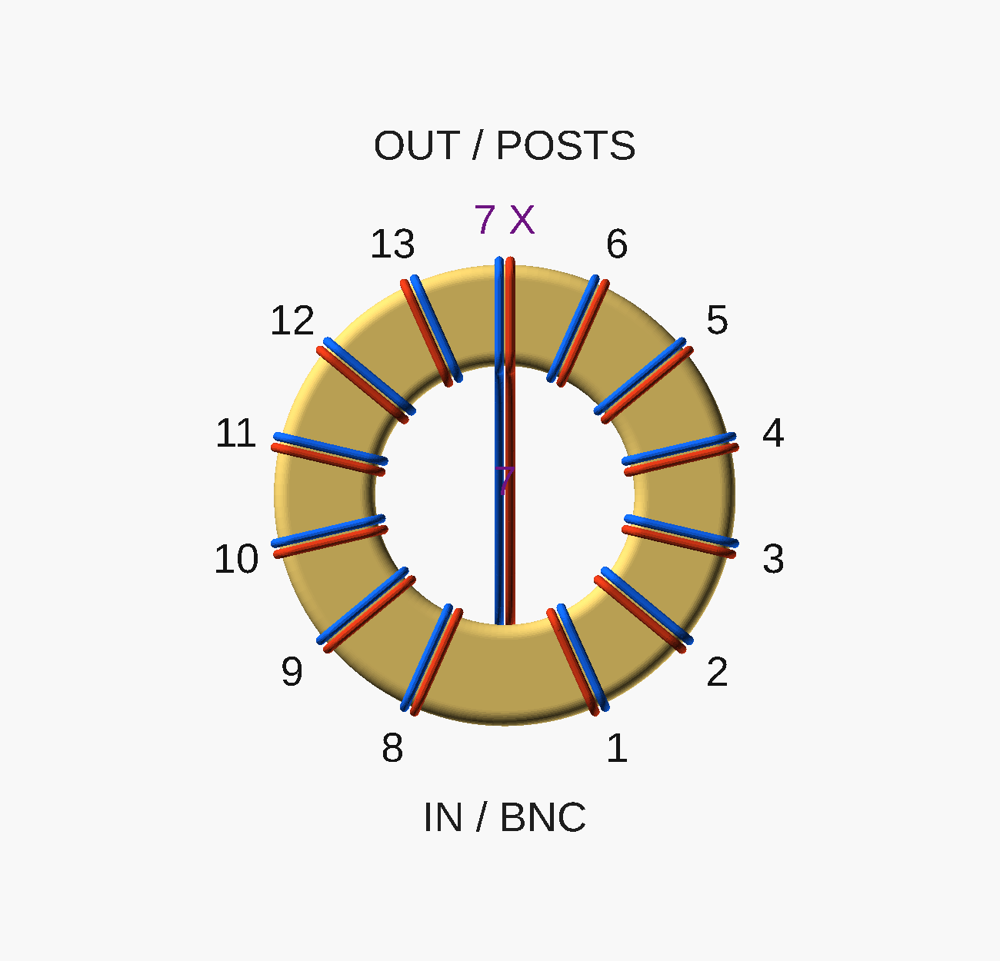

# Thirteen-turn paired winding guide

[Printable STL](winding_guide.stl) · [Parameterized source](winding_guide.scad)
· [Numbered winding](winding_debug.png) · [Installed assembly](assembly.png)
· [Installed cutaway](assembly_cutaway.png) · [Core cutaway](winding_cutaway.png)
· [Print orientation / open underside](winding_print.png)

This separate, open-bottom cup covers the toroid's annular top and both
cylindrical walls. Insert the core from the underside. There is no bottom
cover, enclosed wire tunnel, snap latch, or change to the existing studs or
terminal hardware. Gold is the guide, gray is ferrite, and red/blue identify
the two continuous conductors. Cutaways remove a quadrant **only for viewing**.



The fixed sequence is **six ordinary turns, crossover passage 7, six ordinary
turns: 13 turns per conductor**. Every inner-wall/aperture passage goes from
the covered face toward the open underside. The crossover slopes across the
aperture in that same axial direction. It does not reverse the magnetic
sense, exchange the conductors, or join them together. Each ordinary bank is
automatically spread over 132° with the default 24° lead/crossover reserves.
There are no individual angle settings to enter.

## Parameters and fit

| Parameter | Default | Meaning |
| --- | ---: | --- |
| `core_od` | 29.000 mm | Measured core outside diameter |
| `core_id` | 19.000 mm | Measured core inside diameter |
| `core_height` | 13.850 mm | Measured axial thickness |
| `core_fit_clearance` | 0.150 mm | On each radial surface and above the core |
| `wire_od` | 0.650 mm | Finished diameter, unverified prototype default |
| `wire_surface_gap` | 0.100 mm | Requested enamel-to-enamel gap |
| `groove_fit_clearance` | 0.020 mm | Radial cutter allowance |
| `groove_depth` | 0.100 mm | Shallow open saddle depth |
| `supporting_wall_thickness` | 0.500 mm | Required backing behind groove |
| `edge_rounding` | 1.000 mm | Exterior top corner radius |
| `crossover_clearance` | 0.400 mm | Required clearance to unrelated turns |
| `input_angle`, `output_angle` | −90°, +90° | BNC below / posts above; keep 180° apart |
| `lead_reserve_angle` | 24° | Reserved angle on each side of lead directions |
| `minimum_printable_ridge` | 0.250 mm | Fine-nozzle manufacturing screening threshold |
| `minimum_printable_wall` | 0.450 mm | Manufacturing screening threshold |
| `strict_print_checks` | false | Make manufacturing advisories fatal |

The nominal core dimensions and tolerances are for the
[Fair-Rite 2631801202, mix 31](https://fair-rite.com/product/toroidal-suppression-core-2631801202/):
OD ±0.75, ID ±0.50, height ±0.40 mm. The default cup is sized for the **nominal**
core, not every core allowed by these tolerances. Measure and change the
three core dimensions, then regenerate the STL. Do not compensate for a
larger core by scaling the entire part: that would also change wire spacing.
Any tape at the interface consumes fit clearance.

Wire is [BNTECHGO 22 AWG polyurethane-enamelled copper, B07DYF89T9](https://www.amazon.com/dp/B07DYF89T9).
Bare copper is approximately 0.644 mm; the supplied advertised finished OD
is 0.650 mm. The enamel thickness has not been verified. Neither the code
nor this prototype treats 0.650 mm as a measurement or a dielectric rating.
The requested spacing is an electrical experiment, **not validated 50 Ω
geometry**. See [electrical-design.md](electrical-design.md) for measurement.

## Spacing, ridges, and free spans

The source defines `wire_center_spacing = wire_od + wire_surface_gap`:
**0.750 mm**, independent of groove fit clearance. Each supported pair lies
in parallel meridional planes separated by that amount. These are parallel
tracks, not two constant-angle radial rays. Rear returns use a shared Bezier
centerline with a perpendicular offset for each wire. The second bank's
local offset sign changes to preserve conductor identity across the aperture.

The 0.100 mm wire surface gap is **not** the printable ridge width. With a
0.345 mm cutter radius, 0.100 mm depth and 0.245 mm center offset, each groove
mouth on a flat surface is 0.4858 mm wide. The nominal surface ridge is
**0.2642 mm**. The complete cutter circles would have only 0.060 mm between
them, but their widest portions lie outside the printed surface. Deepening
the grooves destroys that helpful shallow-saddle geometry; clearance never
moves the centerlines apart to hide a collision.
The faceted exported STL measures about 0.268 mm across the top ridge; the
0.2642 mm value is the ideal circular-cutter calculation.

**Manufacturing conflict:** these shallow features are unsuitable for a
routine 0.4 mm-nozzle / 0.2 mm-layer print. Start with a 0.2 mm nozzle and
approximately 0.08 mm layers, inspect the actual sliced ridges, and verify a
physical print. Set `minimum_printable_ridge=0.45` and `strict_print_checks=true`
to reject this geometry under a typical 0.4 mm-nozzle screening assumption.
The threshold is a screening assumption, not a printer qualification. A
0.264 mm ridge also does not make the 0.100 mm groove depth easy to reproduce.

The aperture crossover and rear connecting returns are deliberately **free
wire spans**, guided only at their ends. The cup cannot enforce spacing
there. The CAD keeps the pair together; tension, wire springback, groove
clearance, print error and manual forming determine actual spacing. Keep the
pair ordered with a temporary nonconductive spacing shim while forming it.
Do not assume that tape wrapped around the pair preserves an air gap. If the
free pair closes up or will not hold its shape, this first prototype has not
met the spacing goal: a separate support/separator design is then needed.
No aperture bridge is included because it would add print supports and
complicate core insertion. No wire is silently moved to fix a print conflict.

## Size and installation

| Item | Nominal CAD envelope |
| --- | ---: |
| Separate guide OD × height | Ø30.748 × 14.724 mm |
| Guide central clear aperture, excluding free wires | Ø17.252 mm |
| Core cavity OD / ID / depth | 29.300 / 18.700 / 14.000 mm |
| Wound body, excluding termination tails, tape and ties | Ø31.888 × 17.169 mm |
| Existing wound-body allowance | Ø34.000 × 18.000 mm |
| Remaining diameter / axial allowance | 2.112 / 0.831 mm |
| Re-generated for OD 29.75, ID 18.50, height 14.25 | Ø32.638 × 17.569 mm |

**No allowance or terminal/stud change is required for the modeled prototype.**
The last row changes the core parameters and reprints the cup; it does not
claim that a maximum-size core fits the nominal STL. Tape, winding slack,
groove seating and actual printed fit still need checking against 34 × 18 mm.
The installed preview places the rearmost winding surface on the existing
Z=5 mm pads, so the nominal body reaches approximately Z=22.169 mm, below the
Z=23 mm allowance. Ties, pads and termination tails remain assembly references.

1. Print the supplied STL in its exported orientation: **covered annular
   face toward the bed, open core cavity upward**. The walls rise from that
   annulus. No bulk supports should be necessary; inspect the initial rounded
   edges and shallow bed-facing grooves in the slicer. Supports inside the
   thin channels would be difficult to remove cleanly. Reduce first-layer
   squish/elephant foot and inspect for filled grooves and sharp ridges.
2. Smooth burrs without widening or merging the grooves. Dry-fit the measured
   core from underneath before cutting wire. Protect exposed rear ferrite
   edges if the formed winding touches them. Do not force the core into a
   tight, fragile cup.
3. Start with two continuous **approximately 800 mm** lengths, allowing extra
   for hands and terminations beyond the approximately 0.63 m modeled winding
   route. Identify A and B. Leave input tails toward the BNC.
4. Follow 1–6 on the debug view. Each turn goes from the rear outside edge,
   up the outside, over the annular top, down the inside, then underneath to
   the next outer groove. Form the rear bends gently; pulling them tight onto
   the ferrite would change both the route and spacing.
5. For **7**, take the pair up the reserved upper outer/top grooves and
   **diagonally down through the aperture** to the lower inner landing.
   Carry both wires together without crossing them. A horizontal bridge
   across the front of the hole would not be this counted passage.
6. Follow 8–13 up the other bank. Circumferential progression reverses, but
   every aperture passage is still front-to-rear. Leave the output pair
   toward the upper posts, then split only for the terminal connections.
7. Check all 13 passages, wire clearance, enamel condition, dimensions, DC
   continuity and A/B isolation before mounting. Use the existing compliant
   pads/ties; snug ties must not collapse the rear spacing or crush the guide.
   Repeat dimensional and RF checks after mounting.

## Reproduce and verify

From the repository root:

```sh
mise run balun-center:guide-check
mise run balun-center:render
```

Open `winding_guide.scad` alone to customize/export the guide. `view="print"`
exports only the cup in bed orientation. `guide`, `wound`, `cutaway`, and
`debug` provide inspection views; `data` emits the paths used by the numerical
validator. `mockups.scad` shows the existing center with the guide installed.

[Validation results](winding-guide-validation.json) record the actual checks,
parameter cases and source hashes. The checker reads the generated paths,
counts signed intersections with the aperture disk (13, all in one direction),
checks segment interiors for wire/channel collisions and crossover interference,
checks backing and parameter failures, and verifies the exported mesh and
core insertion. It reports the small free-span polyline spacing error separately
from the exact corresponding-point spacing of the supported tracks. These
are CAD checks; printer capability, enamel safety, physical spacing and RF
performance remain unverified.

The completed check passes five parameter sets (nominal, maximum core
dimensions, changed wire/gap, changed groove clearance, changed core fit),
including actual STL topology and core insertion for each. The default
minimum conservative backing is 0.508 mm around the top and 0.503 mm at the
open rim. The crossover clears unrelated winding by at least 2.038 mm.
The guide is one connected watertight solid, about 1.835 cm³ of material.
Eleven invalid parameter cases are rejected, including the strict 0.4 mm
nozzle ridge check.

The modeled winding's minimum A/B surface separation is approximately
0.093 mm on a tessellated free rear bend. The separate schematic termination
leads narrow to 0.043 mm on an unsupported output bend; they are collision
checked, not spacing fixtures. Neither value replaces the requested 0.100 mm
gap on the supported paths. Physical free bends need forming and inspection.
