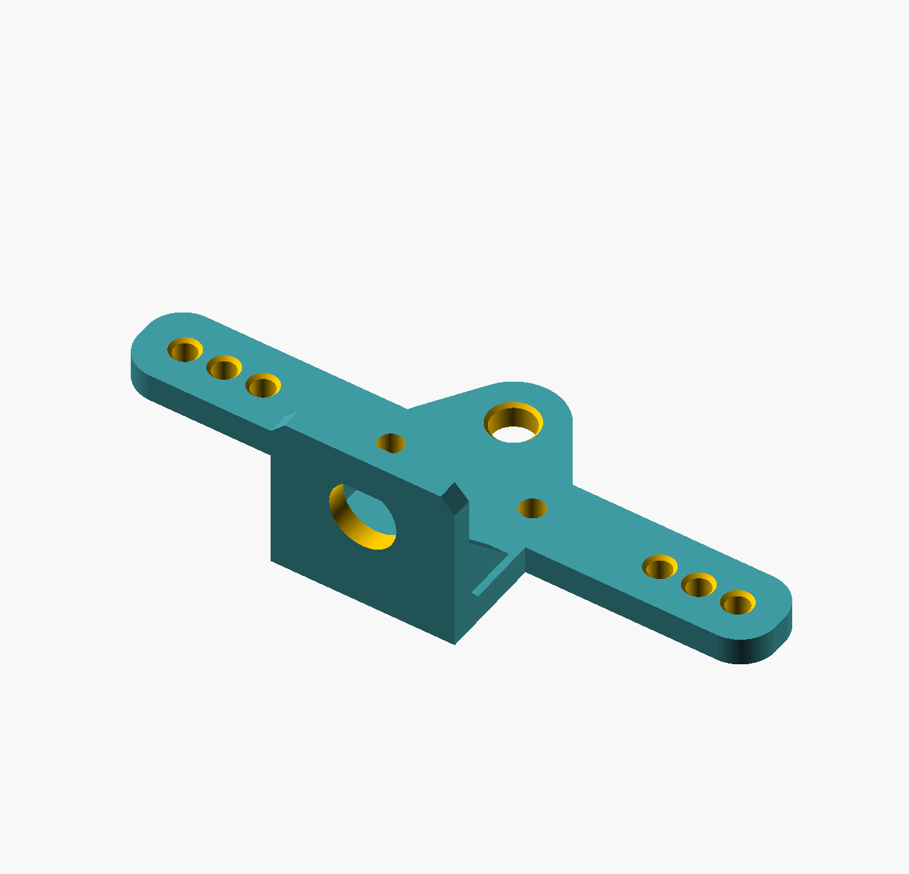
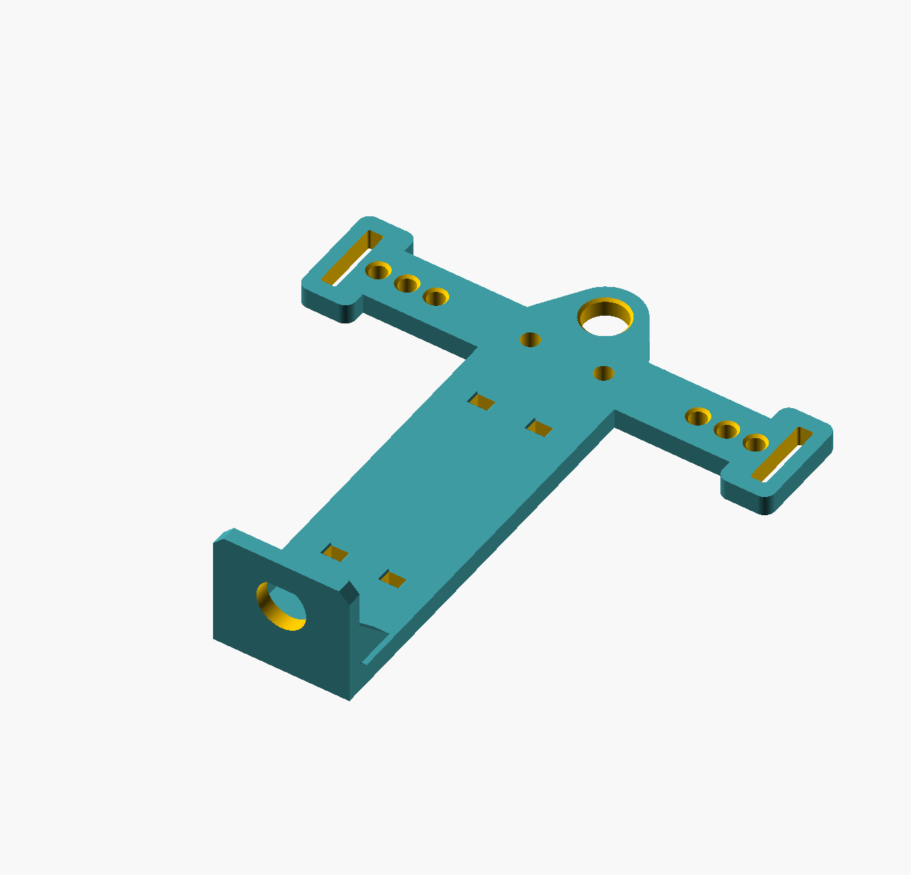
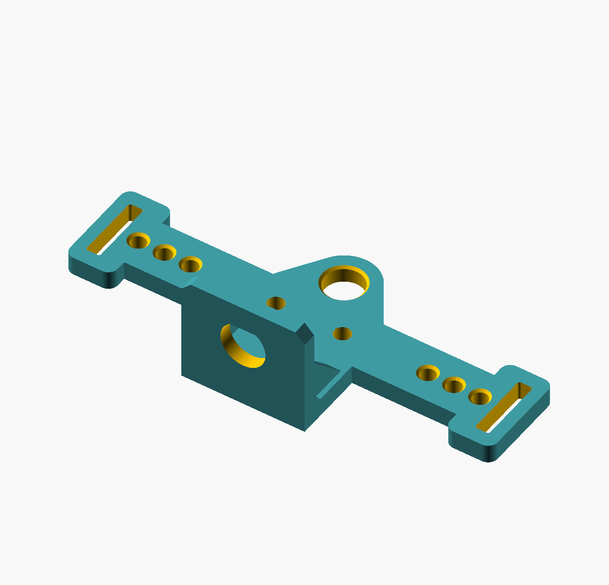

# BNC Dipole Center

**Download on Printables:** [BNC Dipole Center](https://www.printables.com/model/1838086-bnc-dipole-center).

A compact coax-fed dipole center with a downward-facing BNC, two M3 terminal
posts, and three strain-relief holes for each antenna leg. Linking happens in
the antenna wire, so this center is useful for both linked and ordinary dipoles.
Enable `strap_slots` to use this same center with the separate
[nesting winders](../nesting_dipole/README.md). The toggle adds inline strap
slots while retaining the 90 mm overall width.

Enable `balun_mount` to extend the center for an exposed, zip-tied toroid.
The two flags are independent, and all four combinations use this one
self-contained [OpenSCAD source](dipole_center.scad).

| `balun_mount` | `strap_slots` | Configuration | Default size |
| --- | --- | --- | --- |
| `false` | `false` | Original compact center | 90 × 39 × 23 mm |
| `false` | `true` | Compact center with packing strap slots | 90 × 39 × 23 mm |
| `true` | `false` | Open balun center | 90 × 100 × 23 mm |
| `true` | `true` | Open balun center with packing strap slots | 90 × 100 × 23 mm |

With `balun_mount=false`, use a separate feedpoint choke. The original setup
uses RG-316 coax from [ABR Industries](https://abrind.com/) with seven mix 31
ferrite beads. With the mount enabled, follow the
[balun wiring and qualification guide](../balun_dipole_center/electrical-design.md).

## Quick start

Export the current source for the selected **9.5 mm BNC opening** using the
commands below. Print at 100% scale, broad back flat on the bed and BNC shelf
upright. Suggested starting settings: PETG, 0.20 mm layers,
5 walls, 100% infill. Use the
[Amphenol RF 31-221-RFX](https://www.digikey.com/en/products/detail/amphenol-rf/31-221-RFX/100648),
small ring terminals such as Panduit P22-6R-M, and M3 washers about 7 mm in diameter.
The front is the BNC shelf side. Weave the wire before attaching its ring, leave
slack at the terminal, and tug-check the weave. Dry-fit the connector and check
continuity from center to one leg and shell to the other, with no short between them.

For integrated wire storage, see [BNC Dipole Center on Winder](https://www.printables.com/model/1838087-bnc-dipole-center-on-winder).

**Status, 9 September 2026:** the original design printed successfully and felt
sturdy during handling. BNC and terminal hardware fit remains pending. This
widened version and its root reinforcement have not been printed or load-tested.



## Optional balun mount

`balun_mount=true` extends the center spine and moves the complete terminal
bar and suspension eye upward by 61 mm at default settings. Four chamfered
3.4 × 2.4 mm slots secure two nylon ties around the wound toroid. These
**toroid tie slots are controlled by `balun_mount`**, independently of the
larger packing slots controlled by `strap_slots`.

The BNC shelf, 9.5 mm D-hole, ribs and root ramp remain shared. Both terminal
layouts retain 18 mm from each post to its nearest wire hole. The balun
mount reserves a Ø34 × 18 mm wound package and 13 mm of BNC hardware
projection above the shelf (about 12 mm nominal from the catalog). A separate
12 mm gap provides room for the input leads. The wound top is 20 mm below
the posts, leaving 8.824 mm beyond a downward Panduit winding terminal.
See the [clearance review](../balun_dipole_center/clearance.md). See the [balun assembly notes](../balun_dipole_center/README.md)
for pads, ties, hardware and the electrical prototype's limitations.



The combined variant provides the strap openings; it does not establish that
a wound toroid and its wiring fit the existing nesting winder's packing pose.
That loaded arrangement needs a separate fit check. The nesting project
continues to select the compact, non-balun center.

The old `balun_dipole_center.scad` is now a small compatibility preset that
calls this source with the balun mount enabled. For a standalone source file
or all Customizer controls, use `dipole_center.scad`.

## Geometry and revision

| Feature | `strap_slots=false` (default) | `strap_slots=true` |
| --- | --- | --- |
| Width × operating height × depth | 90 × 39 × 23 mm | Same |
| Backplate thickness | 4 mm | Same |
| BNC mounting shelf | 26 mm wide, 3 mm thick | Same |
| BNC cutout | 9.5 mm D-hole, flat uppermost during printing | Same |
| Terminal holes | Two 3.4 mm holes at X = ±10 mm | At X = ±7 mm |
| Wire holes | Three 3.2 mm holes per side at X = ±28, ±33.5, ±39 mm | At X = ±25, ±30.5, ±36 mm |
| Wire-hole pitch | 5.5 mm | Same |
| Terminal to innermost wire-hole centers | 18 mm | Same |
| Suspension hole, automatic size | 6 mm | 8 mm |
| Inline strap slots | None | Two 14 × 3 mm slots |
| Existing corner ribs | Two triangular ribs, each 3 mm thick | Same |
| Added internal root ramp | 2 mm rise and run, with BNC hardware clearance | Same |

### Optional strap slots

In OpenSCAD's Customizer, enable **`strap_slots`** to get the center used by
Nesting dipole. The slots sit at the ends of the terminal and wire bar, with
symmetric end pads to support them. Both the terminals and their three-hole
wire groups move 3 mm inward. This makes room for the slots without increasing
the overall width or reducing the 18 mm terminal-to-inner-hole spacing.
The BNC shelf, ribs and root reinforcement are the same in both configurations.



The default **14 × 3 mm slots** accept roughly 12.7 mm (half-inch) wide
hook-and-loop strap up to 2 mm thick, leaving room for threading. Run a short
strap from one slot around the back of the nested winders to the other slot;
fold and fasten its ends at the slots. See the
[nesting strap guide](../nesting_dipole/README.md#the-short-rear-strap) for the
route and closure details.

`hang_hole_d=0` selects the suspension-eye size automatically: **6 mm without
slots, 8 mm with slots**. Set an explicit 4–8 mm diameter to override it.
Turning slots off restores the original terminal and wire-hole positions and
removes the slot pads; it does not leave unused openings.

The following revision notes describe the original configuration with
`strap_slots=false`.

The first print showed a horizontal line across the outside of the BNC shelf,
near the top of the 4 mm backplate. The original mesh has no modeled seam or
gap there: the shelf extends through the backplate and joins it with overlapping
volume. A print artifact where the broad plate ends and the much smaller upright
section continues is a plausible explanation, not a confirmed diagnosis from
the photograph.

The root reinforcement adds a triangular heel across the inside of that joint.
An 18 mm diameter clearance cylinder around the BNC axis is removed **from the ramp only**,
preserving the circular hardware space between the ribs. The shelf's mounting
surfaces, 3 mm panel thickness, connector cutout, and terminal coordinates stay
unchanged. The ramp adds material at the root; it does not remove the overall
change in printed layer area or promise to eliminate the visible line.

Each three-hole wire group moves 10 mm outward, placing its centers at
`x=±28`, `±33.5`, and `±39 mm`. The terminal centers remain at `x=±10 mm`; both
the terminals and wire holes remain at `y=21 mm`. Widening the body from 70 to
90 mm preserves the 5.5 mm wire-hole pitch and the 6 mm distance from each
outermost hole center to the end of the body. The extra span provides room for
the ring terminal barrel and a slack wire bend, as detailed below.

`root_ramp` accepts 0–2 mm; set it to `0` to disable the ramp on the widened body
for comparison. This does not reproduce the original 70 mm-wide model.
An additional assertion requires at least 1.2 mm of material between adjacent
wire-hole chamfers at the plate faces. The default settings leave 1.3 mm.
The model also requires at least 4 mm between the maximum-length Panduit barrel
opening and the innermost wire-hole chamfer.

Validation of the configuration without strap slots: the regenerated default
STL is one watertight solid measuring 90 × 39 × 23 mm, with all ten holes open. The BNC opening measures 9.5 mm across
the circular portion and 8.65 mm from the flat to the opposite edge. A Boolean
comparison with the previous 9.9 mm export confirms that only the connector
opening changed; the rest of the center geometry is preserved.

## Connector and wire hardware

The owned BNC is the **Amphenol RF 31-221-RFX**, which this model targets. Its
[manufacturer drawing](https://www.amphenolrf.com/en-us/assets/file/4065787961/)
specifies a 9.70 mm D-shaped cutout, 8.85 mm from the flat to the opposite edge,
and a maximum panel thickness of 3.30 mm. The default `bnc_clearance=-0.10`
reduces that cutout by 0.10 mm per side, giving a **9.50 mm cutout** and an
**8.65 mm flat-to-edge dimension**. This is the same fit selected from the
nesting model's finer coupon.
Adjust clearance or print the coupon; do not scale the whole model to fit it.
For a printed opening that is still loose at 9.70 mm, the nesting variant's
[finer fit coupon](../nesting_dipole/bnc_fit_coupon_tight.stl) tests 9.50–9.70 mm
in 0.05 mm steps. These are empirical fits below the recommended cutout,
around the thread's 9.525 mm nominal major diameter. The shared shelf accepts
`bnc_clearance` from -0.10 to 0.25 mm per side. Check your own printer and
connector before changing the selected -0.10 default.

The planned antenna wire is **DX Engineering DXE-SANTW-500**, 26 AWG stranded
copper-clad steel with PE insulation. The owned **Panduit P22-6R-M** uninsulated
ring terminals cover 26–22 AWG and have a 3.86 mm hole that clears an M3 screw.
Their approximately 5.2 mm ring width suits the suggested 7 mm outside-diameter
M3 washers. Panduit specifies copper conductors; that does not establish a
qualified crimp on copper-clad steel. Make sample crimps with suitable small-wire
tooling and pull/flex-test them before wiring the antenna.

For a straight antenna-side approach, the
[Panduit drawing](https://rwjblue.com/downloads/radio/parts/panduit-p22-6r-m-datasheet.pdf)
gives 10.668 ± 0.508 mm from the ring center to the barrel opening. With an
18 mm terminal-to-hole center distance and a 2.1 mm wire-hole chamfer radius,
the widened layout leaves approximately **5.23 mm nominal, or 4.72 mm at the
maximum stated terminal length**, between the barrel opening and the nearest
chamfer edge. This is space for the wire to bend up from the hole while the ring
eye seats flat under its washer; it remains a prototype fit allowance that must
be checked with the actual terminal, wire, and fastener stack.

Suggested terminal hardware is two M3 × 16 mm screws, four nuts, and eight small
M3 washers; choose screw length after checking the actual assembled stack.
With the balun mount disabled, two short insulated jumpers connect the BNC
center and shell to separate posts. With it enabled, route both conductors
through the choke winding as described in the electrical guide.

1. Dry-fit the BNC, mounting nut, washer/tag, and coax plug. Its mating barrel
   points down in service, with its flange below the shelf and its solder contact
   and mounting nut/tag above it. Orient the shell solder tag outward between the
   ribs, away from the backplate. Check tool access and clearance before
   tightening; the complete hardware stack has not yet been physically checked.
2. Install each M3 screw from the back. A fixed base nut can retain the BNC
   jumper, with a second nut and washers clamping the antenna ring terminal.
   Avoid crushing the plastic while tightening.
3. **Weave each antenna wire through its holes before crimping the ring.** From
   the outermost hole inward, pass back-to-front, front-to-back, then
   back-to-front. The ring will not pass through a 3.2 mm hole. Leave slack between
   the innermost hole and the terminal so antenna tension goes into the weave.
4. Pull-test the strain relief with the actual wire. Ring terminals prevent
   unthreading the wire for a quick swap without removing the terminal.
5. Before connecting the radio, check continuity from the BNC center to one post
   and shell to the other, with no short between them. Support heavy coax or a
   choke separately so their weight does not load the connector.

## Printing and checking the visible line

Print with the **broad backplate flat on the bed and the BNC shelf standing up**,
as exported by `part="center"`. The
[finer fit coupon](../nesting_dipole/bnc_fit_coupon_tight.stl) includes the
current 9.5 mm default. The legacy `part="coupon"` output has larger 9.7, 9.9,
and 10.1 mm openings. Both reproduce the upright D-hole and its 3 mm panel
thickness. The upper flat requires a short bridge. Fit the actual connector
without forcing it and remove print artifacts as needed.

The original suggested starting profile was plain PETG, 0.20 mm layers,
5 perimeters, and 100% infill. The successful print's exact material and slicer
profile were not recorded here, so those settings are not a validated recipe.

For a subsequent print, inspect the sliced layers around `z=4 mm`, including
outer-wall speed, layer time, and cooling changes as the backplate finishes.
Compare changes one at a time against the successful print's profile.
[Prusa's explanation of the Benchy hull line](https://help.prusa3d.com/article/the-benchy-hull-line_124745)
describes how changes in layer content, timing, and cooling can produce a visible
line without a corresponding seam in the CAD. It is background for this
hypothesis, not a diagnosis of this particular printer or print.

## Useful parameters

Dimensions are millimeters. Existing STL files are fixed meshes; after changing
a parameter, render (F6) and export a new STL. Print at 100% scale.

| Parameter | Default | Purpose |
| --- | --- | --- |
| `balun_mount` | `false` | Extend the spine and add toroid mounting tie slots |
| `package_d` | 34 | Wound toroid OD, 32–38 mm; changes balun-center height |
| `package_h` | 18 | Wound thickness, 16–22 mm; reference envelope only |
| `pad_t` | 1 | Separate pad thickness, 0.5–2 mm; reference envelope only |
| `bnc_rear_projection` | 13 | Hardware envelope above shelf, 10–20 mm; raises the balun mount |
| `bnc_to_toroid_gap` | 12 | Free input-lead space beyond BNC envelope, 10–20 mm |
| `toroid_to_post_gap` | 20 | Wound top to M3 post center, 20–28 mm; reserves winding-ring clearance |
| `show_fit_envelope` | `false` | Display wound-package allowance in F5; excluded from STL |
| `strap_slots` | `false` | Enable inline slots and the nesting center's hole layout |
| `strap_slot_width` | 14 | Slot length for the strap's width; used when slots are enabled |
| `strap_slot_thickness` | 3 | Slot width for the strap's thickness; used when slots are enabled |
| `bnc_clearance` | -0.10 | Per-side adjustment to the nominal 9.70 mm BNC cutout; -0.10 gives 9.50 mm |
| `hang_hole_d` | 0 | Automatic 6 mm without slots / 8 mm with slots, or explicit 4–8 mm |
| `terminal_hole_d` | 3.4 | M3 screw clearance |
| `wire_hole_d` | 3.2 | Insulated-wire clearance |
| `wire_chamfer` | 0.5 | Wire-hole and suspension-eye mouth chamfer |
| `root_ramp` | 2 | Shelf-root reinforcement; 0 disables it |

For a chosen BNC coupon diameter `D`, use `bnc_clearance=(D-9.70)/2`.
The circular diameter and anti-rotation flat change together. The nesting
entry point offers the same adjustment directly as `bnc_hole_d`.

With slots enabled, increasing their thickness can consume the web beside the
nearest wire hole. At default wire-hole sizes and chamfers, **3 mm** is the
largest compatible Customizer step. The 3.5 and 4 mm settings need smaller
wire holes or chamfers. Geometry assertions reject incompatible settings.

## Export

Run these commands from the repository root. STL files are generated outputs and
are ignored by the repository.

```sh
cd models/ham_radio/dipole_center
openscad -o dipole_center.stl dipole_center.scad
openscad -o dipole_center_with_straps.stl -D 'strap_slots=true' dipole_center.scad
openscad -o dipole_center_with_balun.stl -D 'balun_mount=true' dipole_center.scad
openscad -o dipole_center_with_balun_and_straps.stl -D 'balun_mount=true' -D 'strap_slots=true' dipole_center.scad
openscad -o balun_mount_coupon.stl -D 'balun_mount=true' -D 'part="mount_coupon"' dipole_center.scad
openscad -o dipole_center_BNC_9p7.stl -D 'bnc_clearance=0' dipole_center.scad
openscad -o dipole_center_BNC_9p9.stl -D 'bnc_clearance=0.10' dipole_center.scad
openscad -o dipole_center_BNC_10p1.stl -D 'bnc_clearance=0.20' dipole_center.scad
openscad -o BNC_upright_fit_test.stl -D 'part="coupon"' dipole_center.scad
openscad -o dipole_center_no_root.stl -D 'root_ramp=0' dipole_center.scad
```

`dipole_center_no_root.stl` is a widened version without the ramp for comparison
only. Use `dipole_center.stl` without slots or
`dipole_center_with_straps.stl` for the nesting winders. At default fit settings,
the latter is the same center exported as Nesting dipole's `center.stl`; both
come from this model's geometry.

`part="operating"` rotates the model into its service orientation for viewing;
use `part="center"` for the intended print orientation.

## Validation and previews

From the repository root:

```sh
mise run dipole-center:check
mise run dipole-center:render
mise run balun-center:check
```

The shared-center check exports all four STLs and verifies connected,
watertight meshes, dimensions, terminal/wire/eye positions, strap-slot webs,
BNC fit, and the balun package and tie clearances. It also checks the
combined configuration at the supported package/projection extremes and
compares the compatibility preset and nesting center with their shared
variants. Results are in [validation.json](validation.json).
The existing balun check also exports its two fit coupons.

During consolidation, Boolean comparisons against saved pre-change exports
found no volume differences for the plain, straps-only and balun-only models.
The subsequent [hardware clearance revision](../balun_dipole_center/clearance.md)
raised the balun variants from 88 to 100 mm for lead and ring-terminal space;
the compact variants remain unchanged.
The combined configuration is a new, physically untested variant.

## Provenance

Imported from the ChatGPT-generated `linked_dipole_center_v2` download dated
9 September 2026, originally named `linked_dipole_center_v2.scad`. Renamed to
`dipole_center.scad` on import, with the internal root ramp and wire-web assertion,
then widened for ring-terminal clearance as described above.
Referenced manufacturer drawings retain their own terms.

This is an open feedpoint with no established weatherproofing, mechanical load,
or RF power rating. Successful printing and mesh checks do not establish those
properties.

The original model is shared under [CC BY-NC-SA 4.0](https://creativecommons.org/licenses/by-nc-sa/4.0/).
