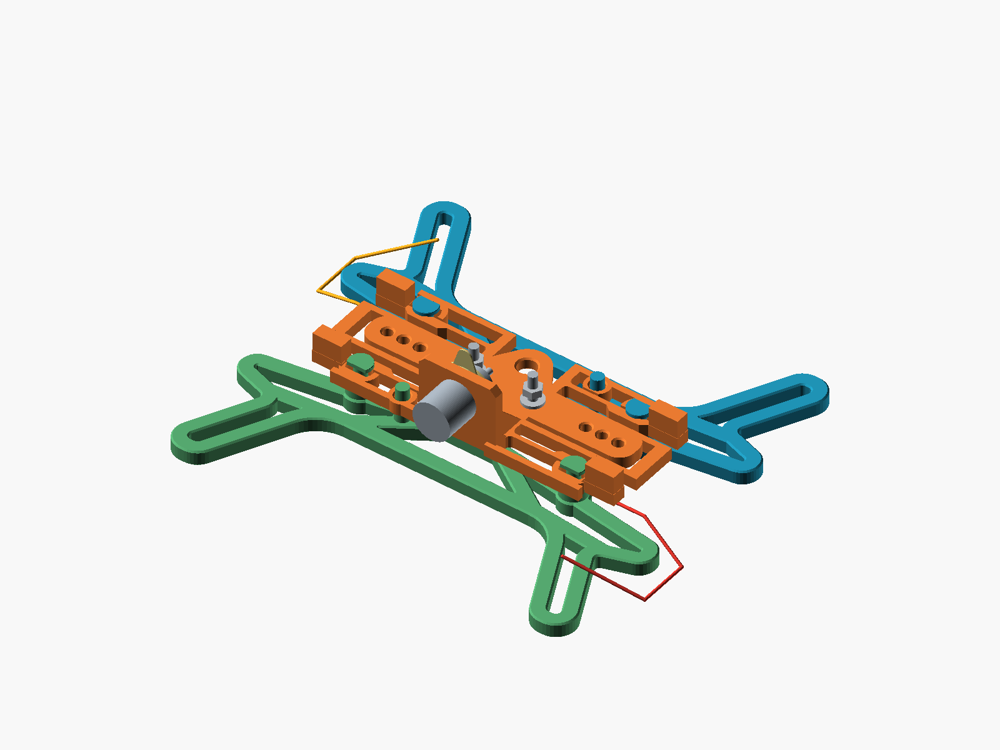
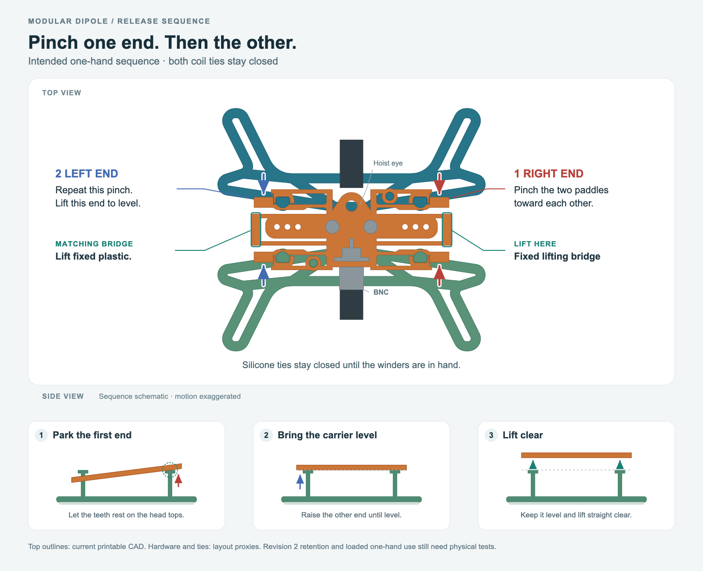

# Modular dipole center with removable winders

A BNC dipole center and two separate K6ARK-style wire winders that clip together
for packing. Each antenna leg gets its own figure-eight winder, so you can
unwind it as you walk outward from the center. Print **one center and two
identical winders**.

**Prototype status:** the first print had comfortable spring controls but
failed retention. The second print's larger lips helped, but the winders still
came free. Revision 3 increases the lips again and needs a physical retention
test. The compact 4 mm supports overlap the assumed wire space in CAD; check
the actual loaded fit, finger access and gloves before field use. Increase
`standoff` if the center cannot seat freely.

## Hardware

Use an Amphenol RF 31-221-RFX BNC, two M3 × 16 mm screws, four M3 nuts,
eight M3 washers, two compact ring terminals, antenna wire, two short jumpers,
suspension cord and two short silicone ties. Follow the
[BNC Dipole Center assembly instructions](https://www.printables.com/model/1838086-bnc-dipole-center)
for terminal wiring and the three-hole strain relief. Leave relaxed tails and
check continuity to each leg with no center-to-shell short. Fully unwind both
legs before operating.

## Print

| File | Quantity / purpose |
| --- | --- |
| [center.stl](center.stl) | One center with 10.1 mm BNC opening |
| [winder.stl](winder.stl) | Two identical winders with 4 mm supports |
| [print_layout.stl](print_layout.stl) | Alternative complete three-piece plate |

Print at 100% scale with the broad backs flat on the bed and the center's BNC
shelf upright, as supplied. Starting settings are PETG, 0.20 mm layers, five
walls and solid infill. Inspect the short BNC bridge and stud-head undersides
in the slicer. These are separately printed parts; the spring tabs are integral
to the center, and the assembly is **not print-in-place**.

Use a **revision-3 center and two revision-3 winders** with matching support
heights. The larger heads require matching receiving passages; do not reuse
revision-1 or revision-2 parts in this set. Within revision 3, the center can
be reused when you change only the winder support height. Both wire-space
presets use the same print set.

Optional printer-fit coupons and their instructions remain in the
[build notes](review/BUILD.md#fit-coupons). The
[test procedure](review/DESIGN.md#physical-acceptance) covers the complete
loaded assembly.

## Release and deploy

With the BNC at the bottom and hoist eye at the top, each end has an upper and
lower tab. Pinching the right pair releases the right stud of **both** winders;
the left pair releases both left studs.

1. Support the tied winders on a surface or your lap. Pinch one end's tabs
   inward with thumb and forefinger. Use another finger on the **fixed lifting
   edge** between them to raise that end, keeping the winders down.
2. Let the tabs return and gently rest that end on the flat stud tops. It
   stays raised while you move the same hand to the other end.
3. Pinch the other pair and lift its fixed edge until the center is level.
   Then lift it clear of the guide pins. Either end can go first.
4. Secure the center low at the mast. Open one coil tie and unwind that leg
   as you walk outward. Repeat for the other leg, then hoist.

Allow the winders to settle slightly along their guides during release. Lift
using fixed plastic, and level the center before lifting it off. The temporary
resting position is for handling, not transport. Supported one-hand operation
and glove comfort still need testing with actual wound wire.

## Wind and pack

Wind each leg **tip first, toward the center**, in a figure eight. This leaves
the center end outside the coil for deployment. Leave roughly 100–150 mm of
relaxed tail, adjusted to the actual hardware and release path.

Keep one short silicone tie captive around each winder's central brace and
close it around the coil before docking. The intended ties are the short UMUST
silicone cable ties; their button and strap fit still need checking. Align the
studs, **pinch to seat each end**, and release the tabs beneath the heads.
Straight push-in docking is not intended. Keep wire tails outside the slots
and lifting edges, and gently pull-check both ends. An outer bundle tie is
available as backup.

## Adjustable dimensions

Open [modular_dipole.scad](modular_dipole.scad) in OpenSCAD's Customizer. The
main controls are:

| Parameter | Default | Adjusts |
| --- | ---: | --- |
| `wing_length` | 37.5 mm | Reach to the winder horn tips |
| `winding_span` | 140 mm | Span between the lower outer tips |
| `standoff` | 4 mm | Winder top to center underside; try 5.5 or 8 mm for more room |
| `bnc_hole_d` | 10.1 mm | BNC cutout diameter, retaining its D-flat |

The [full parameter table and export examples](review/BUILD.md) include
strain-relief spacing and hole sizes. `preset="40m"` and `preset="80m"` change
only the displayed coil reservation; neither changes support height or proves
wire capacity. Measure the actual wound bundle and choose dimensions to suit it.

The default bare assembly is approximately **140 × 127 × 32 mm**, before wire,
ties and metal hardware. The print plate occupies about **140 × 180 mm**;
allow brim space or use the separate files.

See the [one-page flyer](marketing/README.md) for the packing idea, the
[build notes](review/BUILD.md) for regeneration, and the
[design review](review/DESIGN.md) for mechanical checks and limitations.
The winder profile derives from Adam Kimmerly's K6ARK design; attribution and
CC BY-NC-SA 4.0 terms are in [NOTICE.md](NOTICE.md).
