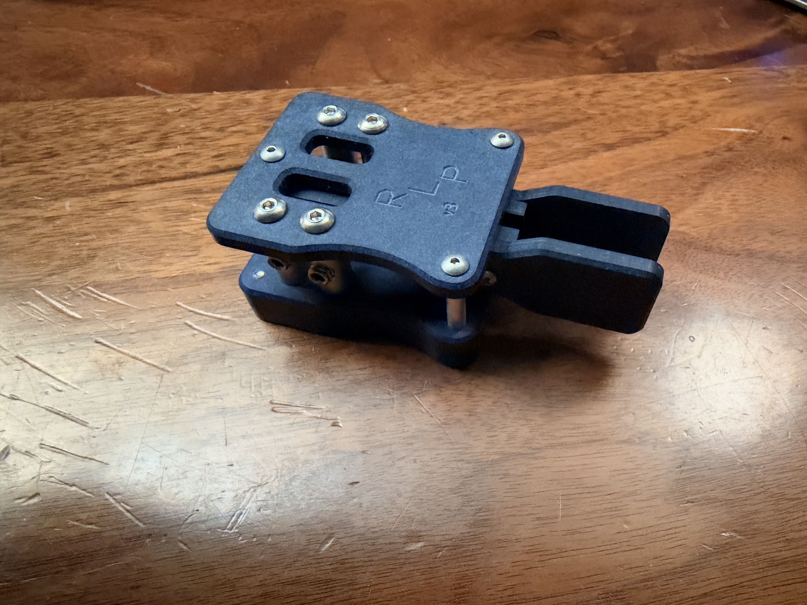

# N0SA RLP V3 magnetic paddle guard

A small cover for the exposed finger pieces on an N0SA RLP V3 Morse-code paddle. It slides over the front of the key and stays in place with two magnets, keeping the paddles covered while the key is in a field bag. Pull it off when you are ready to operate.

## About the key

The RLP V3 is a lightweight iambic paddle made by Larry Naumann, N0SA, for portable amateur-radio use. It connects to an electronic keyer, often built into the radio: one lever requests dots and the other requests dashes. Its small size makes it a good companion for Parks on the Air (POTA) and Summits on the Air (SOTA).



*The RLP V3 without a guard. Photo and product reference: [N0SA’s original QRZ listing](https://forums.qrz.com/index.php?threads/n0sa-sota-pota-paddles.1007636/).*

The listing gives the key’s size as **72 × 35 × 25 mm** and its weight as **48 g**. It has a Richlite body, four precision ball bearings, adjustable magnetic return and a 3.5 mm stereo jack. Four magnets in the base allow it to attach to a steel surface. The guard lines up with the **two base magnets closest to the paddles**; the key keeps all four of its magnets.

## What the guard does

The guard covers the finger pieces with a closed nose, roof, sides and bottom. Two small stops meet the stationary body so the guard seats against the key rather than the moving levers. The rear edge is straight all the way around, with no projecting tongue underneath.

It prints as one piece. There are no clips, screws or modifications to the key. This model is sized for the **RLP V3**; check dimensions before trying it on another paddle.

**Prototype fit note:** check the complete guard on your key before gluing in the magnets. The roof needs to clear the button head screws as the guard slides on, and both levers should move freely once it is seated.

## What you need

- **One printed guard:** `rlp_v3_guard.stl`.
- **Two neodymium disc magnets:** **6 mm diameter, approximately 3 mm thick**, magnetized through the thickness.
- A small amount of **cyanoacrylate (super glue)** suitable for the printed plastic and magnet coating.

The pockets are **6.20 mm wide and 2.95 mm deep**. Magnet dimensions vary, so check the actual discs before gluing. The fit dimensions use a **2.96 mm thick magnet**, which is nominally 0.01 mm proud of a 2.95 mm seat. A disc that measures a full 3.00 mm will stand 0.05 mm proud unless the pocket is adjusted. The optional depth gauge makes this easier to check without committing a whole guard.

Use metric 6 mm magnets; a true ¼-inch disc is 6.35 mm and will not fit these pockets. Scale the print at **100%**. If your magnets need a different pocket size, change that dimension in OpenSCAD rather than scaling the entire guard.

## Printing

The guard STL is already oriented **nose-down**, with the closed end on the build plate and the rear opening facing up. Keep that orientation.

| Setting | Starting point |
|---|---|
| Material | PETG |
| Nozzle | 0.4 mm |
| Layer height | 0.20 mm |
| Walls | 3 |
| Supports | Off |
| Scale | 100% |

Nose-down printing avoids a wide roof bridge. Look over the pocket ceilings and the two small stops in the sliced preview, and remove any loose strands before fitting the key. The print occupies about **41.67 × 33.32 mm** on the plate and stands **41.47 mm** tall.

## Fit and assembly

1. **Try the empty guard first.** Slide it over the paddle end until both stops meet the stationary body. Check clearance over the top screw heads while sliding it on, then move each lever through its full travel and check the roof, sides and nose for contact.
2. **Try both magnets without glue.** They should sit fully in their pockets. Clean away any printing debris rather than forcing a tight magnet into place.
3. **Check each magnet’s polarity separately.** Hold it against its matching key magnet and mark which face belongs inside the pocket. Each one must attract the key.
4. **Glue the magnets into the guard.** Put a tiny amount of glue in each shallow center recess and press the magnet fully onto the surrounding flat seat. Wipe away squeeze-out and let the glue cure with the guard off the key.
5. **Check the finished fit.** The guard should attach and come off smoothly, and the paddles should remain clear of the shell. Check retention with gentle handling before packing it in a bag.

The center recess gives a little space for glue while the flat ring around it sets the magnet’s seating depth. The finished guard has closed pocket bottoms. Test coupons have small holes underneath so a pin can push the magnets back out between trials.

## Dimensions

All dimensions are in millimeters. The key specifications above describe the paddle; these dimensions describe the **guard**.

| Feature | Dimension |
|---|---:|
| Overall width × length × height, fitted orientation | **41.67 × 41.47 × 33.32** |
| Rear opening, central width × height | **38.07 × 27.07** |
| Finger piece top / nose ceiling, above key underside | **25.24 / 25.74** |
| Magnet pockets | **Ø6.20 × 2.95 deep** |
| Magnet center-to-center spacing | **15.51** |
| Magnet centers behind the key’s front body edge | **4.50** |
| Glue recess in each pocket | **Ø2.50 × 0.10 additional depth** |
| Bottom thickness | **4.25** |
| Plastic beneath the magnet seating ring | **1.30** |
| Plastic beneath the glue recess | **1.20** |
| Side / roof / nose wall thickness | **1.80 / 2.00 / 2.00** |
| Clearance above the floor to the key underside | **0.25** |
| Central paddle-tip clearance when seated against the stops | About **1.9** |
| Each stop, width × depth × height | **3.30 × 1.60 × 3.20** |

The thicker bottom accommodates the magnets; the top and sides stay thinner to keep the cover compact. The 1.20 mm backing is a conservative design choice, rather than a tested minimum thickness.

The inside floor stays flat. The roof slopes down gently over the finger pieces, with 0.50 mm of nominal headroom at the nose centerline and about 0.59 mm at the paddle-tip reference. The rear opening and the nose ceiling are separate dimensions.

For CAD reference, the key underside is Z=0, its front body edge is Y=0, and +Y points toward the paddle tips. Pocket centers are X=±7.755, Y=−4.50. The floor is at Z=−0.25, the central rear ceiling at Z=26.82, the rear rim at Y=−10.30, and the inside/outside nose faces at Y=29.17/31.17. The paddle-tip reference is Y=27.11. The opening has rounded corners, so its central width and height do not describe the clearance at those corners.

## Optional fit tools

`rlp_v3_height_coupon.stl` is a short collar with the same rear roof, sides, magnet seats and stops as the guard. Both ends are open so the paddles can pass through. Use it to check screw-head clearance and seating before printing the full cover. Slide it straight onto the key and check that the screw heads clear the roof throughout insertion. It ends before the taper; check clearance over the finger pieces with the full guard.

Keep the collar’s supplied orientation, standing on its cut front rim, and use the same 0.20 mm PETG settings with supports off. Its footprint is **41.67 × 33.32 mm**, but it is only **12.80 mm tall**. Two 2 mm holes let you push the trial magnets back out without glue.

`rlp_v3_floor_coupon.stl` leaves the top open so you can see the paddle tips while checking magnet alignment and stop contact. The solid line marks the inside nose wall; the dashed line marks the paddle-tip reference. Measure tip clearance to the **center of the solid line**, rather than the outside edge of the print.

`rlp_v3_depth_gauge.stl` has five labeled 6.20 mm pockets at **2.50, 2.65, 2.80, 2.95 and 3.00 mm** deep. Try the same magnet in each pocket without glue, then use a pin through the underside hole to remove it. The notched end is shallowest. Print it in its supplied edge-down orientation at **0.10 mm layers**, supports off; pocket depth then runs horizontally, so tiny differences are not rounded to the layer height.

These are separate fit tools, not pieces of the finished guard. The source also includes a smaller alignment coupon, a diameter gauge and a combined test plate.

## Editable source

The self-contained `n0sa_rlp_v3_guard.scad` exports the guard in its print orientation by default:

```sh
openscad --backend=Manifold --hardwarnings --export-format=binstl \
  -o output/rlp_v3_guard.stl \
  models/ham_radio/n0sa_rlp_v3_guard/n0sa_rlp_v3_guard.scad
```

Set `part="height_coupon"`, `part="floor_coupon"` or `part="depth_gauge"` for the main fit tools. `print_orientation="as_used"` shows the full guard in its fitted position for inspection.

The main adjustments are `body_internal_width`, `body_internal_height`, `paddle_top_above_key_base`, `paddle_roof_clearance`, `production_pocket_depth`, `pocket_diameter_extra`, `magnet_min_floor` and `tip_clearance`. Set the nose ceiling from the finger-piece height and desired headroom. The pocket depth and backing thickness are separate, so reducing the backing removes material from the outside without moving the magnet seat or roof.
