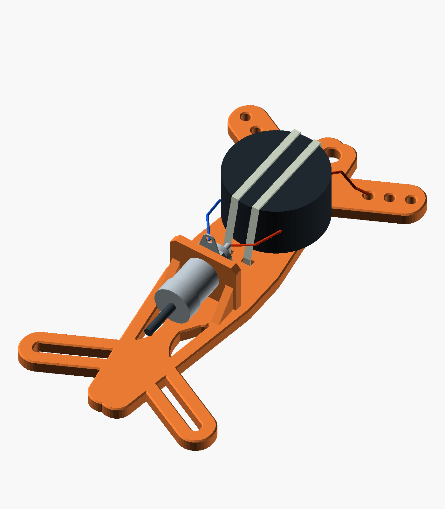
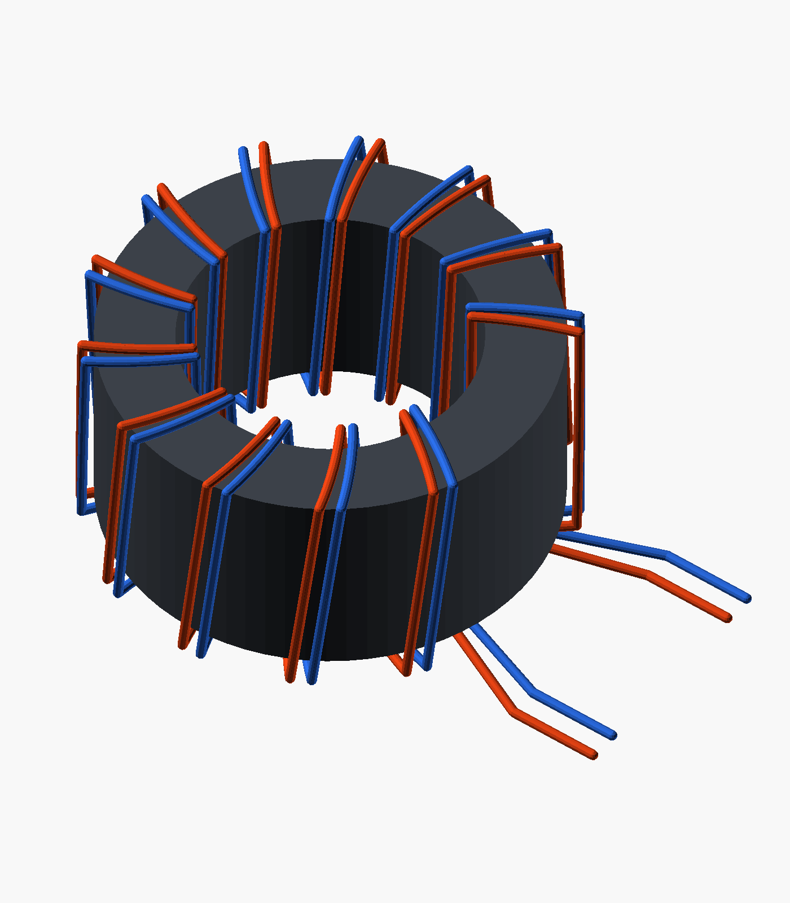
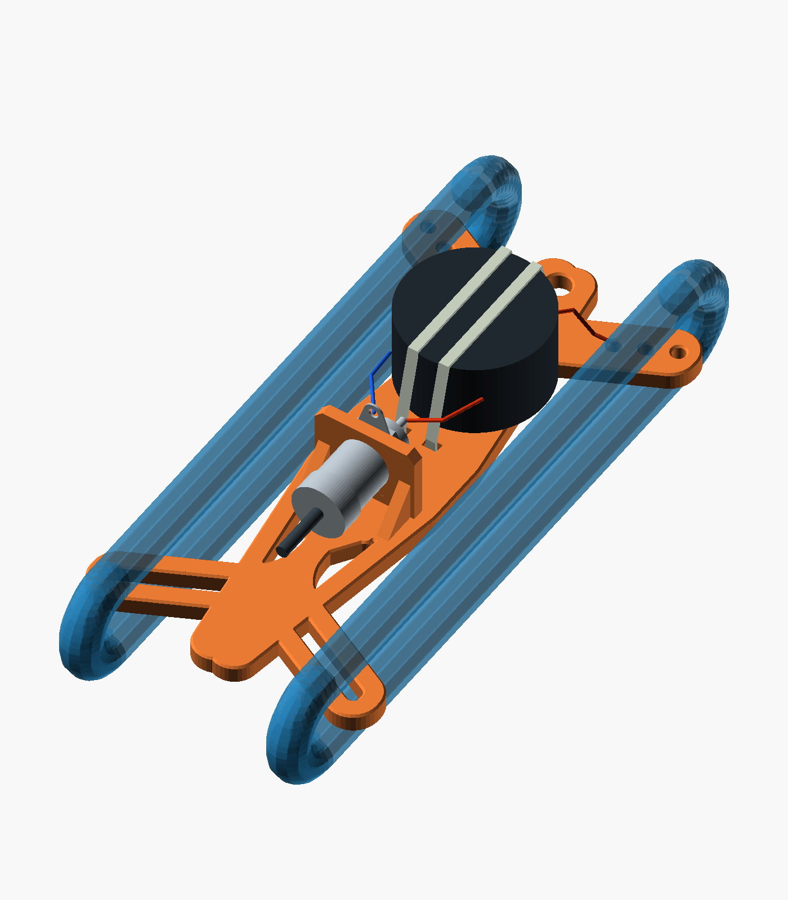

# Dipole winder with a heatshrunk 1:1 balun

An open-mount alternative to the [direct-feed dipole winder](../dipole_winder/README.md).
Use **one Fair-Rite 2631801202 mix 31 toroid, with 12 bifilar turns of 22 AWG
enamelled copper wire**. The core is listed in the [N1RWJ parts bin](https://rwjblue.com/radio/equipment/parts-bin/).
The intended use is mostly **10 W CW**, with occasional operation below 100 W.
**This is an unbuilt prototype, with no measured RF performance or power rating.**
The working band assumption is **40–10 m**; see the [electrical design and test procedure](electrical-design.md).

**Print:** [winder STL](toroid_dipole_winder.stl) · [mount fit coupon](toroid_mount_test.stl).
**Edit:** [OpenSCAD model](toroid_dipole_winder.scad).



The dark cylinder depicts the **maximum wound-and-shrunk package envelope**,
not a printed case. The actual sleeve will follow the winding's shape. Metal,
wires, cushion and ties are schematic references and are absent from the STL.
See the [front](front.png), [side](side.png), and [bare printed part](preview.png).

## What changed and why

The original winder's BNC occupies the space needed by a toroid near the upper
arms. This variant moves the BNC down the spine and mounts the toroid flat
above it. Its 75 × 140 mm winding outline, 5 mm frame, hanging eye, six wire
holes and their chamfers are retained. A narrow spine supports the package
and its straps. The two central windows are filled where the new spine would
otherwise leave narrow wire-catching slits; four lower windows remain.

Two nylon ties pass over the **whole packet**, through four slots and around
the back of the spine. This works even if heatshrink covers the toroid's
central hole. A small closed-cell cushion protects the winding and supplies
grip. Snug the ties only enough to stop movement; check lateral sliding and
twisting before soldering. The straps support the core's mass. The original
wire weave and hanging eye carry antenna tension. Secure the coax to the
support cord with a relaxed service loop at the BNC.

The selected core is **29 × 19 × 13.85 mm and 24 g**. The smaller listed mix 31
core is 7 g; the FT114-43 is 13 g. The selected core trades those possible
11–17 g savings for winding room and more ferrite, with published measurements
on this exact part. This does not prove its higher-power capability. The
larger FT140-43 is 33 g before winding. The [selection comparison](electrical-design.md#selecting-from-the-parts-bin)
explains the alternatives and cites the manufacturer data.

## Dimensions and materials

| Feature | Default |
| --- | ---: |
| Printable part | 75 × 140 × 24 mm |
| Frame / BNC mounting panel thickness | 5 / 3 mm |
| Finished toroid allowance | Ø36 × 20 mm |
| Toroid centre | X0, Y31 mm |
| Cushion | 14 × 30 × 1 mm, at X±7, Y16–46 |
| Tie slots | 3.4 × 2.4 mm, 0.3 mm mouth chamfers |
| Slot centres | X±4, Y9 and Y53 mm |
| BNC cutout | Ø10.1 mm with 0.85 mm top flat depth |
| BNC shelf top / axis | Y−8.3 / Z15 mm |
| Rear-contact estimate above shelf | 12 mm; measure the actual connector |
| Rear-contact to nearest slot mouth | 3.8 mm |
| Reserved connector hardware diameter | 18 mm |
| Approximate assembled thickness | 30 mm including front straps and rear tie heads |

The BNC remains the **Amphenol RF 31-221-RFX**, with the same fit allowance as
the original winder. Point its shell solder tag away from the frame. Its full
nut/tag/plug fit and the estimated rear projection require the actual parts.

The verified mesh gives **31.06 g of solid PETG**, only **2.67 g more than the
original winder** at the same assumed density. For the electrical module,
allow roughly **31–36 g including wire, insulation, cushion and ties**.
Add the printed-part mass and the actual BNC hardware mass;
the complete feedpoint is expected to be around **70–80 g before antenna wire
and coax**. This is a planning estimate, not a scale measurement. Exact mesh
volume and the solid-PETG estimate at 1.27 g/cm³ are in [validation.json](validation.json).
Heatshrink avoids the walls, lid and fasteners of a full enclosure.

Other supplies: two **2.5 × 200 mm nylon cable ties**, thin PTFE tape, two
650 mm lengths of heavy-build enamelled 22 AWG wire, flexible insulated
splice leads if needed, and approximately **38–40 mm expanded-ID thin-wall
heatshrink**. The inventory's 9 mm sleeve is too small. Choose a cushion that
does not collapse completely under light strap tension. Use separate small
insulating sleeves over solder joints. Heatshrink is not a waterproof seal.

## Printing and assembly

Print broad back at Z0 on the bed, shelf upright, at 100% scale. PETG,
0.20 mm layers, five walls and 100% infill are the original model's starting
settings. The reinforced shelf starts on the bed. Supports are not intended;
inspect the short D-hole bridge and tie-slot openings in the slicer.

1. Wind and electrically check the toroid using [these instructions](electrical-design.md).
   Each of the two conductors makes 12 passes through the aperture. Keep
   them electrically separate: BNC centre → conductor A → one dipole leg;
   BNC shell → conductor B → the other leg. There is no series junction.
2. Heatshrink the tested module **off the printed part**, then measure it.
   The fit coupon contains the actual shelf, spine and strap positions for
   checking the packet, mounting stack and ties together.
3. Thread the suspension cord and weave the antenna legs through their three
   holes, outside inward: back-to-front, front-to-back, back-to-front. Leave
   relaxed tails. Follow the original winder's [threading diagram](../dipole_winder/threading.svg).
4. Install the BNC, cushion and packet. Route the two ties through the lower
   slots, over the packet and through the upper slots; latch behind the spine
   and cut tails flush. Tug and twist the package gently. If it slides, improve
   the cushion's grip rather than crushing the winding with the ties.
5. Keep input leads together and short, with slack at the connector. Route
   the antenna-side leads above the packet toward the original relief holes.
   Fit the real shell tag and coax plug before trimming and soldering.
6. Repeat continuity and RF measurements after sleeving and mounting. Check
   wire-weave grip and that cord/coax loads do not reach the solder joints.
   Start deployment tests at 10 W before assessing any higher power.



This winding illustration shows the topology and four free ends. Its wire
spacing and lead lengths are illustrative; the actual close pair must be
checked for both differential input match and common-mode impedance.

## Winding space



Keep stored wire outboard of **X±22 mm** beside the packet. At its widest
point the default packet reaches X±18 mm, leaving 4 mm to those corridors.
Keep splice leads inside that boundary too. The illustrated bundles are
10 mm wide at X±27, with generous wraps beyond the horns. They show a clear
route and reserved space, **not a measured winding capacity or guaranteed
packed size**. Wind the intended lengths of actual antenna wire to confirm
capacity, grip, finger access and snag resistance. Disconnect coax for packing;
fully unwind both antenna legs before transmitting.

## Customization and verification

`package_d` accepts 32–38 mm and moves the straps and shelf to retain their
clearances. Increasing `bnc_rear_projection` lowers the shelf. `bnc_hole_d`
and `bnc_flat_depth` adjust connector fit. Keep the model at 100% scale.
`package_h` and `foam_t` describe the fit envelope; the open mount needs no
different printed height. Set `show_package=true` in F5 to see that envelope;
it never enters an STL. The saved assembly illustrations use the defaults.

From the repository root:

```sh
mise run toroid-winder:check
mise run toroid-winder:render
```

The check task exports both STLs and measures the resulting meshes, retained
horns and holes, tie mouths, D-cutout, hardware clearance, cushion support and
representative parameter limits. [validation.json](validation.json) records the
source hashes, geometry and explicit limitations. The [source and attribution](NOTICE.md)
remain tied to the adjacent original winder files, so keep those directories
together when moving the editable model.

CAD verification does not establish printed strength, actual wire capacity,
weather resistance, choke impedance or a power rating. The electrical notes
provide the remaining bench and deployment checks for this prototype.
